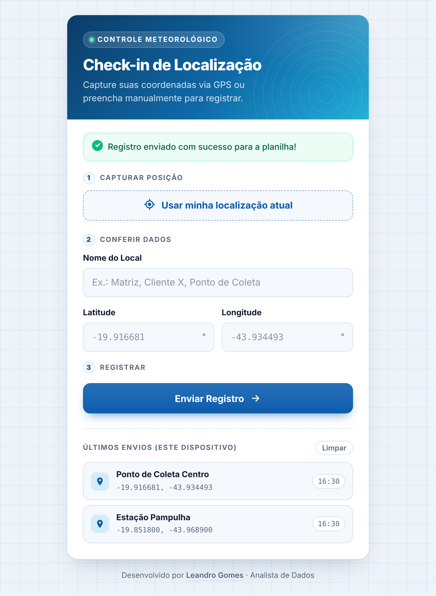
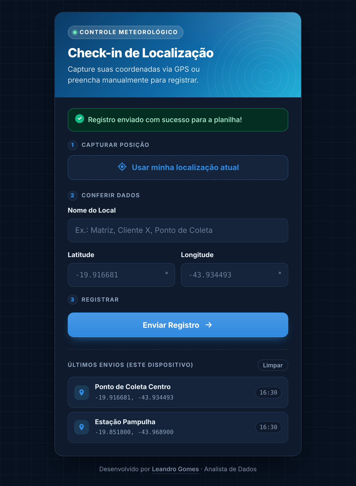
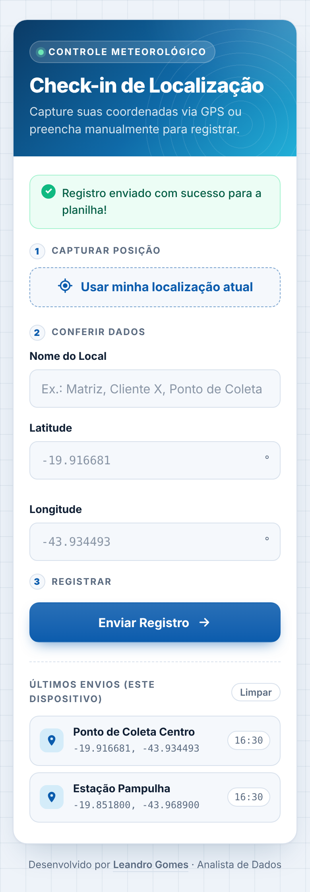
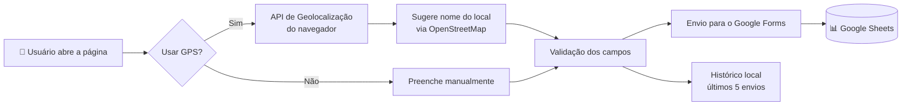

# 📍 Check-in de Localização · Controle Meteorológico

Aplicação web leve para **registrar pontos de coleta em campo**: com um toque, captura as coordenadas GPS do celular, sugere o nome do local e grava o registro direto em uma **planilha do Google Sheets**, sem servidor nem banco de dados próprio.

🔗 **Acesse:** [leandroanalytics.github.io/controle_meteorologico-](https://leandroanalytics.github.io/controle_meteorologico-/)


---

## 🎯 O problema

Em uma rotina de coleta em campo, anotar onde cada registro foi feito costuma ser manual: alguém escreve o endereço, copia coordenadas do mapa ou manda mensagem para o time. Isso gera **erros de digitação, locais com nomes diferentes para o mesmo ponto e dados espalhados**, difíceis de analisar depois.

**A solução:** uma página que qualquer pessoa abre no celular, sem instalar nada, e que envia cada check-in padronizado (local + latitude + longitude + data/hora) para uma planilha única, pronta para análise.

---

## 🖼️ Telas

| Tema claro | Tema escuro | Celular |
|:---:|:---:|:---:|
|  |  |  |

---

## ⚙️ Como funciona



1. **Capturar posição:** o botão de GPS lê latitude e longitude com alta precisão (6 casas decimais).
2. **Conferir dados:** o nome do local é sugerido automaticamente (geocodificação reversa) e pode ser editado; um mini mapa mostra o ponto, com link para o Google Maps.
3. **Registrar:** os dados são validados e enviados ao Google Forms, que grava cada linha na planilha com data e hora.

---

## ✨ Funcionalidades

- 📍 **Captura por GPS** com tratamento de erros (permissão negada, sinal indisponível, tempo esgotado)
- 🏷️ **Sugestão automática do nome do local** a partir das coordenadas
- ✅ **Validação:** campos obrigatórios, latitude entre -90 e 90, longitude entre -180 e 180, e aceita vírgula ou ponto como separador decimal
- 🗺️ **Mini mapa de conferência** antes do envio
- 🕓 **Histórico no próprio aparelho** com os últimos 5 envios
- 🌙 **Tema claro e escuro automático**, conforme a configuração do dispositivo
- 📱 **Responsivo e acessível:** foco visível no teclado, mensagens anunciadas por leitores de tela e respeito à preferência de reduzir animações

---

## 🛠️ Tecnologias

| Camada | Ferramenta | Papel |
|---|---|---|
| Interface | HTML5 + CSS3 | Layout responsivo, tema escuro, sem frameworks |
| Lógica | JavaScript (vanilla) | GPS, validação, envio e histórico |
| Localização | Geolocation API | Coordenadas do dispositivo |
| Nome do local | Nominatim (OpenStreetMap) | Geocodificação reversa |
| Coleta de dados | Google Forms → Google Sheets | Armazenamento sem backend |
| Histórico | localStorage | Últimos envios no aparelho |
| Hospedagem | GitHub Pages | Publicação gratuita |

> 💡 **Decisão de arquitetura:** usar o Google Forms como "backend" elimina custo de servidor e banco de dados, e entrega os dados direto numa planilha que o time já sabe usar.

---

## 📊 Perguntas de negócio

Visão de gestor: o que a base gerada pela aplicação permite responder, e o que ela **não** responde.

### ✅ A base responde

| Pergunta | Por que importa |
|---|---|
| Quantos registros foram feitos por local e por período? | Mostra a cobertura da operação e se a rotina de coleta está sendo cumprida |
| Quais locais concentram mais registros e quais estão sendo esquecidos? | Ajuda a redistribuir esforço de campo para pontos pouco visitados |
| Em que dias e horários os registros acontecem? | Revela o padrão de trabalho e possíveis lacunas (ex.: nenhum registro no fim de semana) |
| Os pontos registrados estão onde deveriam estar? | Coordenadas fora da área esperada indicam erro de digitação ou registro indevido |
| O mesmo local aparece com nomes diferentes? | Mede a qualidade do cadastro e a necessidade de padronizar nomes |

### ❌ A base não responde (hoje)

| Pergunta | O que falta |
|---|---|
| **Quem** fez cada registro? | Não há campo de usuário ou responsável |
| Como estava o **tempo** no momento do registro? | A página registra a localização, mas não coleta dados meteorológicos (temperatura, chuva, umidade) |
| Qual a **precisão** do GPS em cada ponto? | A precisão informada pelo aparelho não é enviada |
| O registro foi feito **no local** ou digitado depois? | Não há campo indicando se as coordenadas vieram do GPS ou foram digitadas |

Esses pontos estão em **Próximos passos**.

---

## 🚀 Como usar no seu projeto

1. **Faça um fork** ou clone o repositório:
   ```bash
   git clone https://github.com/leandroanalytics/controle_meteorologico-.git
   ```
2. **Crie um Google Forms** com 3 perguntas de resposta curta: *Nome do Local*, *Latitude* e *Longitude*, e vincule a uma planilha.
3. **Pegue os IDs dos campos:** no Forms, use *"Gerar link pré-preenchido"* e copie os códigos `entry.XXXXXXX` de cada pergunta.
4. **Atualize o `index.html`** com o link do seu formulário e os IDs:
   ```js
   const FORM_ACTION_URL = "https://docs.google.com/forms/d/e/SEU_ID/formResponse";
   const FIELDS = {
     local: "entry.XXXXXXX",
     latitude: "entry.XXXXXXX",
     longitude: "entry.XXXXXXX",
   };
   ```
   > Lembre de trocar também o atributo `name` dos três `<input>` pelos mesmos IDs.
5. **Publique no GitHub Pages:** *Settings → Pages →* escolha o branch e salve.

> ⚠️ O GPS só funciona em páginas **HTTPS** (o GitHub Pages já é). Abrindo o arquivo direto no computador, use o preenchimento manual.

---

## 📁 Estrutura

```
controle_meteorologico-/
├── index.html      # Página completa (HTML + CSS + JavaScript)
├── docs/           # Prints usados neste README
└── README.md
```

---

## ⚠️ Limitações conhecidas

- **Confirmação de envio:** o Google Forms não devolve resposta ao navegador (envio em modo `no-cors`). A mensagem de sucesso indica que o envio saiu do aparelho; a confirmação final é a linha na planilha.
- **Precisão do GPS** varia conforme o aparelho e o ambiente (prédios e áreas fechadas reduzem a precisão).
- **Histórico local** guarda só os 5 últimos envios e fica apenas naquele navegador.
- **Sugestão de nome** depende do serviço público do OpenStreetMap; se ele falhar, o campo fica para preenchimento manual.

## 🔒 Privacidade (LGPD)

Coordenadas de localização podem ser **dados pessoais**. A página só captura a localização quando o usuário clica no botão e o navegador pede permissão. Em uso real, vale informar quem tem acesso à planilha e por quanto tempo os dados ficam guardados.

---

## 🔭 Próximos passos

- [ ] Campo de **responsável** pelo registro
- [ ] Enviar a **precisão do GPS** e a origem da coordenada (GPS ou manual)
- [ ] Integrar uma **API de clima** para gravar temperatura, umidade e chuva no momento do check-in
- [ ] **Dashboard** (Looker Studio ou Power BI) com mapa dos pontos e volume por período
- [ ] Funcionamento **offline**, com envio quando a conexão voltar

---

## 👤 Autor

**Leandro Gomes** · Analista de Dados
[GitHub](https://github.com/leandroanalytics) · [LinkedIn](https://www.linkedin.com/in/leandroanalytics)
